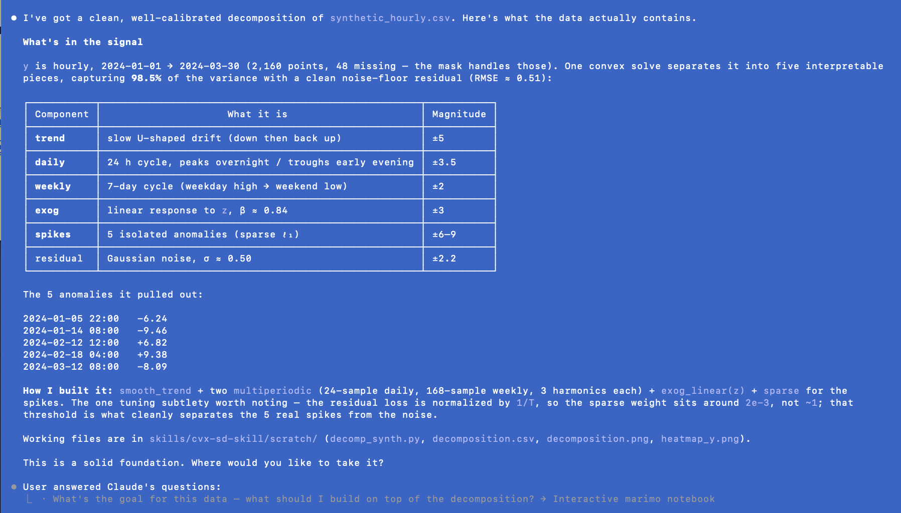

# Convex Signal Decomposition Skill

Separate a time series into parts you can interpret: a long-term trend,
repeating patterns, occasional spikes, or a response to another measured
variable. The residual is what those components leave unexplained. The library
is designed for one value per time step on an evenly spaced grid.

- **`signaldecomp` is the Python library.** Combine built-in components or write
  your own in [CVXPY](https://www.cvxpy.org/), a language for modeling
  optimization problems. The library assembles a convex problem and calls a solver
  (Clarabel by default).
- **[The agent skill](SKILL.md) is a set of instructions and worked examples.**
  Use it in a compatible coding tool to explore a dataset, turn a question
  into a model, and check the fitted components before drawing conclusions.
  You can use the library without the skill.

## Try an example

Install [uv](https://docs.astral.sh/uv/getting-started/installation/), the tool
used here to set up the Python environment and run examples. The library
requires Python 3.12 or newer. Then clone the repository with Git and run:

```bash
git clone https://github.com/cvxgrp/cvx-sd-skill.git
cd cvx-sd-skill
uv sync --locked
uv run python -m marimo edit examples/gasoline_price_trends.py
```

This opens a [marimo](https://marimo.io/) notebook in your browser. The weekly
gasoline-price data are included. Try different trend shapes and compare what
each leaves in the residuals.

## Fit a trend and weekly cycle in Python

This example creates a daily series with a three-day gap. Save it as `demo.py`
in the checkout and run `uv run python demo.py`.

```python
import numpy as np
from signaldecomp import (
    make_problem, solve, components_to_frame,
    smooth_trend, multiperiodic, period_samples,
    SECONDS_PER_DAY, SECONDS_PER_WEEK,
)

day = np.arange(56)
y = 10 + 0.05 * day + np.sin(2 * np.pi * day / 7)
y[20:23] = np.nan  # Leave missing days in place on the regular grid.
week = period_samples(SECONDS_PER_WEEK, SECONDS_PER_DAY)

built = make_problem(y, components=[
    smooth_trend(1e2, role="trend"),
    multiperiodic(week, num_harmonics=1, role="weekly"),
])
out = solve(built)
df = components_to_frame(out, y=y)
print(df.loc[19:23, ["y", "trend", "weekly", "reconstruction"]])
```

The input column `y` still shows `NaN` on the missing days. The reconstruction
is the sum of the fitted trend and weekly cycle, so it has estimates there too.

## Worked examples

- [Weekly gasoline prices](examples/gasoline_price_trends.py): compare linear,
  smooth, piecewise-linear, and piecewise-constant trends in an interactive
  notebook with included data.
- [Response to a lagged input](examples/lagged_exogenous_response.py): fit a
  nonlinear response to current and past values of another signal, then score
  predictions on data left out of the fit. Run it from the checkout with
  `uv run python examples/lagged_exogenous_response.py`.
- [Solar panel degradation](examples/pvdaq4_degradation.py): estimate an annual
  degradation rate from daily normalized energy. This notebook requires a
  separate [data preparation step](examples/prep_pvdaq4_daily_y.py).

## Use the agent skill

If you have Node.js and `npx`, use the [Skills CLI](https://skills.sh/docs) to
install the instructions for a compatible coding tool:

```bash
npx skills add cvxgrp/cvx-sd-skill
```

Installing the skill does not install the Python library. Once the library is
available in your project, try a request like:

> Use the convex signal decomposition skill with `hourly_load.csv`. Check the
> timestamps and look for daily and weekly patterns. Suggest components to try
> and explain how I can check them before settling on a model.

The screenshot shows a demonstration on synthetic hourly data, where the
patterns were known in advance. It illustrates the workflow, not a guarantee
that the same components fit your data.



## Install the library in another project

To install directly from GitHub, run this in your project's Python environment
(Python 3.12 or newer, with Git available):

```bash
python -m pip install "signaldecomp @ git+https://github.com/cvxgrp/cvx-sd-skill.git"
```

For reproducible installs, append `@` followed by a commit hash to the URL.
You can also build a wheel from a checkout with `uv build --wheel` and install
the resulting `.whl` file from `dist/`. The library installation does not
include marimo or the example notebooks and data. See the
[portable notebook instructions](reference/marimo.md#project-environment-and-portable-copies)
if you want to run a copied example.

## Data and models

Keep gaps in the grid rather than dropping those rows; see the
[time preparation guide](reference/time-axis.md) for working with timestamps.
The fit uses rows where the signal and all required inputs are available.

Choose the components to match the question. In addition to trends and cycles,
the [component catalog](reference/component-catalog.md) includes sparse events,
grouped effects, and linear or spline responses to other variables, with
options for lags and interactions. The library fits the model you specify; it
doesn't infer the right decomposition or provide an end-to-end forecasting
workflow. See the [validation and reporting guide](reference/downstream.md) for
checks on the fitted model and what its uncertainty intervals measure.

## Feedback

If you try it on your own data, please
[open an issue](https://github.com/cvxgrp/cvx-sd-skill/issues) to share what
worked, what was unclear, or what kind of model you couldn't express.

## Citation & prior work

Meyers, B. E., & Boyd, S. P. (2023). *Signal Decomposition Using Masked Proximal
Operators.* Foundations and Trends in Signal Processing, 17(1), 1–78.
[DOI: 10.1561/2000000122](https://doi.org/10.1561/2000000122)

## License

Apache License 2.0 — see [LICENSE](LICENSE) and [NOTICE](NOTICE). The natural
cubic spline basis, grouped components, and interaction design include
BSD-3-Clause-derived work; see
[THIRD_PARTY_NOTICES.md](THIRD_PARTY_NOTICES.md).
Copyright 2025 Bennet Meyers and the Alliance for Sustainable Energy, LLC.
